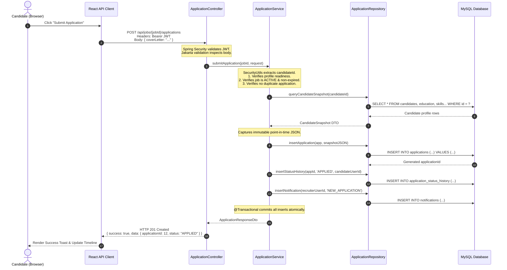
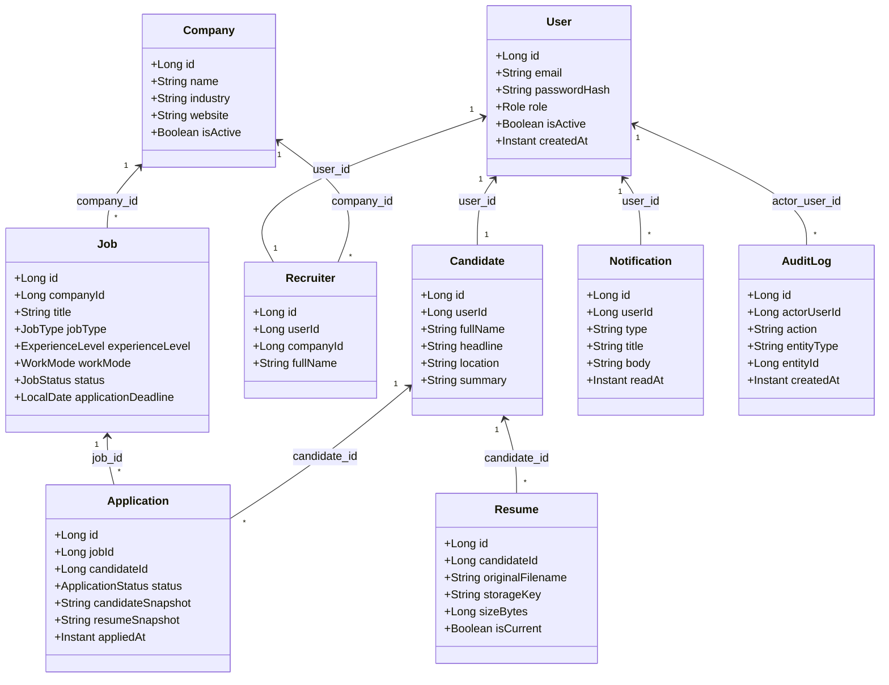
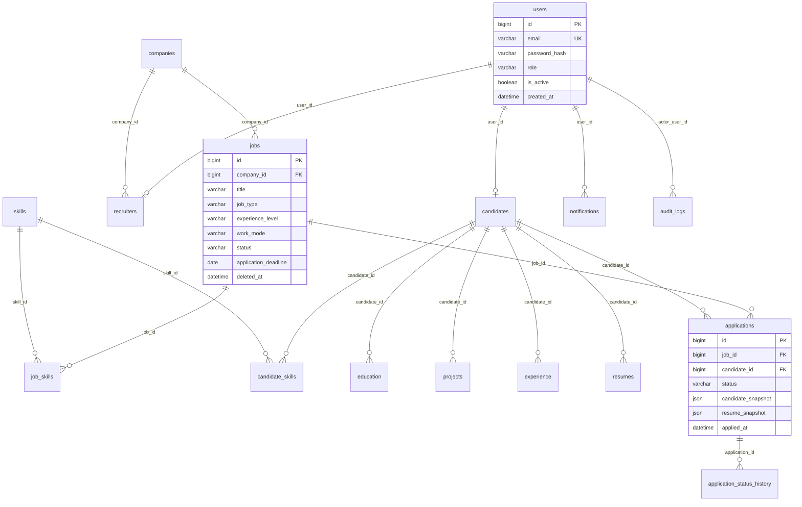

# CareerConnect — Final Academic Report
## Comprehensive Architecture, Implementation, and Evaluation Specification

---

### Title Page

* **Project Title**: CareerConnect
* **Project Subtitle**: Early-Career Recruitment Platform
* **Domain**: Full Stack Web Development / Enterprise Software Engineering
* **Backend Framework**: Spring Boot 3.3.4 (Java 21 LTS)
* **Frontend Framework**: React 19 (TypeScript, Vite)
* **Database Management System**: MySQL 8.0 (InnoDB, Flyway Versioning)
* **Data Access Layer**: Spring `JdbcTemplate` (Strictly No ORM / No JPA)
* **Testing Stack**: JUnit 5, MockMvc, Vitest, React Testing Library
* **Architecture**: Three-Tier Monolithic Modular Layered Architecture
* **Status**: Complete & Verified (Release Gate P9.7 / Academic Gate P9.8)
* **Document Version**: 1.0 (Final Submission)

---

## 1. Executive Summary & Project Overview

CareerConnect is an institutional, candidate-first early-career recruitment platform specifically engineered for students, fresh graduates, interns, and entry-level professionals (0–2 years of experience).

Traditional recruitment platforms are designed primarily for experienced hires. They burden early-career candidates with complex resume parsers, uncalibrated automated ranking algorithms, and opaque application black holes where status updates are rarely provided. Conversely, employers seeking entry-level talent are overwhelmed with disorganized candidate pools lacking verified skill alignment.

CareerConnect bridges this divide by providing:
1. **Public Discovery**: Transparent browsing of verified company profiles and entry-level job opportunities without mandatory account creation.
2. **Deterministic Skill Matching**: A mathematical, transparent skill alignment formula ($$\text{Match \%} = \text{round}\left(100 \times \frac{\text{Matched Required Skills}}{\text{Total Required Skills}}\right)$$) that gives candidates clear feedback on fit before applying—without arbitrary AI black-box scoring.
3. **Structured Application Lifecycle**: A strict, server-enforced state machine governing status transitions (`APPLIED` $\rightarrow$ `UNDER_REVIEW` $\rightarrow$ `SHORTLISTED` $\rightarrow$ `INTERVIEW` $\rightarrow$ `SELECTED` / `REJECTED` / `WITHDRAWN`).
4. **Point-in-Time Immutable Snapshots**: Archival-grade JSON snapshots of candidate profiles and resumes captured at the exact instant of application, preserving historical integrity regardless of subsequent profile modifications.
5. **Role-Segregated Management**: Tailored operational workflows for Candidates, Recruiters, and Platform Administrators backed by server-authoritative security boundaries.

---

## 2. Problem Statement

Early-career job seekers face three structural hurdles:
* **Fragmented Opportunity Discovery**: Entry-level postings are frequently mixed with senior roles requiring several years of experience, forcing fresh graduates to sift through irrelevant listings.
* **Lack of Application Transparency**: After submitting applications, candidates often experience total silence, lacking visibility into whether their profile was reviewed, shortlisted, or rejected.
* **Skill Misalignment without Actionable Feedback**: Generic rejection emails fail to clarify which specific technical proficiencies were missing from candidate resumes.

Simultaneously, recruiters face:
* **Unstructured Influx of Applications**: Difficulty rapidly evaluating candidate readiness and skill overlap.
* **Compliance & Historical Auditing Risks**: Modifying candidate profiles or deleted job postings often corrupt historical records or create dangling pointers in enterprise databases.

CareerConnect directly resolves these challenges with normalized domain models, immutable application snapshots, transparent deterministic matching, and strict state transitions.

---

## 3. Project Objectives

1. **Deploy a Production-Grade Spring Boot 3 Backend**: Build a resilient RESTful API utilizing Java 21 LTS, clean three-tier layered architecture, and explicit SQL with `JdbcTemplate`.
2. **Eliminate ORM Obfuscation**: Avoid heavy JPA/Hibernate abstraction layers in favor of parameterized SQL statements, explicit `RowMapper` implementations, and deterministic transaction management.
3. **Enforce Server-Authoritative Security**: Implement stateless HMAC-SHA256 JWT bearer authentication, memory-only client token storage, and strict ownership validation preventing cross-tenant data tampering.
4. **Implement Immutable Data Snapshots**: Guarantee that submitted applications retain the exact profile details and resume metadata present at submission time.
5. **Deliver a Modern, Accessible Frontend**: Build a responsive React single-page application using modern design standards (Stitch Design 2: emerald primary, warm off-white background, clean surfaces, and responsive layouts).
6. **Achieve Comprehensive Test Coverage**: Verify system correctness with 680 automated backend tests, 178 frontend tests, and 62 automated end-to-end integration release gates.

---

## 4. Project Scope

### 4.1 V1 Implemented & Fully Verified
* **Authentication & Authorization**: Registration, login, logout, role guards (`CANDIDATE`, `RECRUITER`, `ADMIN`), 30-minute stateless JWTs, memory-only client session storage.
* **Public Discovery**: Full-text and filtered search for active jobs and verified companies, pagination, sorting, and detail views.
* **Candidate Workflow**: Profile management, education, platform skills, projects, work experience, PDF resume upload (with magic byte validation), application readiness validation, deterministic matching, application submission, status timeline tracking, and candidate self-service withdrawal.
* **Recruiter Workflow**: Company profile creation and onboarding, job lifecycle (`DRAFT` $\rightarrow$ `ACTIVE` $\rightarrow$ `CLOSED`), applicant inspection, immutable candidate snapshot view, protected PDF resume streaming, application status updates, and soft-deletion protection.
* **In-App Notifications**: Transactional notification fan-out on status transitions and job closures, unread count polling, mark-as-read, and deep links.
* **Admin Moderation & Audit**: Platform dashboard metrics, user activation/deactivation, company activation/deactivation, job archiving and restoration strictly to `CLOSED`, application review, and immutable audit logs.

### 4.2 Intentionally Deferred
* **Saved Jobs**: While the relational database table `saved_jobs` exists in MySQL, client-side saving and corresponding API endpoints were intentionally deferred to preserve frozen V1 release boundaries.

### 4.3 Future Enhancements (Strictly Out of Scope for V1)
The following capabilities are explicitly classified as Future Enhancements and are not part of the V1 production release:
* Automated email verification & self-service password reset
* Recruiter teams, multi-seat organizations, and employer verification tiers
* AI/ML recommendation systems, automated candidate ranking, or chatbot interfaces
* Real-time chat, instant messaging, and automated interview scheduling
* Skill assessments, coding challenges, and proctored examinations
* Payment gateways, billing, and paid job promotions
* Mobile native applications (iOS / Android)
* Internationalization (i18n) and multi-currency billing

---

## 5. Users and Roles

The platform enforces four explicit actor roles:

| Actor | Authentication | Scope & Capabilities | Server-Side Security Invariants |
| :--- | :--- | :--- | :--- |
| **Guest** | Unauthenticated | Browse active jobs and verified companies; register as Candidate or Recruiter; log in. | Cannot view candidate profiles, submit applications, view recruiter dashboards, or access moderation tools. |
| **Candidate** | `ROLE_CANDIDATE` | Manage own profile, education, skills, projects, experience, resume; evaluate match; submit applications; view status timeline; withdraw applications; read notifications. | Can access **only** own candidate records (`candidate_id` extracted from JWT claims). Cross-candidate access returns generic 404/403. |
| **Recruiter** | `ROLE_RECRUITER` | Manage claimed company profile; create, publish, close, and soft-delete own company jobs; inspect applicants to company jobs; update applicant status; download applicant resumes. | Can access **only** jobs and applications belonging to their own claimed `company_id`. Client-supplied IDs in body or URL are strictly ignored. |
| **Admin** | `ROLE_ADMIN` | Inspect platform metrics; moderate users (activate/deactivate); moderate companies; archive/restore jobs; inspect any application and resume; review immutable audit logs. | Seeded/provisioned account only. No public registration. Enforces self-deactivation protection (admin cannot deactivate themselves). |

---

## 6. Technology Stack

### 6.1 Backend Stack
* **Language & Runtime**: Java 21 LTS (Amazon Corretto / Eclipse Temurin). Leverages Java Records, Pattern Matching, and Modern Type Inference.
* **Framework**: Spring Boot 3.3.4.
* **Web Layer**: Spring MVC (`@RestController`, `@RequestMapping`, `@Valid`).
* **Security Layer**: Spring Security 6.3 with stateless `SecurityFilterChain` and custom `OncePerRequestFilter` Bearer token parsing.
* **Database & Persistence**: MySQL 8.0 Community Server. All interactions executed through Spring `JdbcTemplate` with parameterized SQL statements. **Strictly zero JPA or Hibernate dependencies.**
* **Connection Pooling**: HikariCP (configured for connection health checks, pool sizing, and leak detection).
* **Database Migration**: Flyway Community Edition versioning SQL schema files (`V1__create_core_schema.sql`).
* **Validation**: Jakarta Bean Validation (`hibernate-validator`).
* **Password Hashing**: BCryptPasswordEncoder (work factor 12).
* **Testing**: JUnit 5 (Jupiter), AssertJ, Mockito, Spring Boot Test (`MockMvc`).

### 6.2 Frontend Stack
* **Language & Library**: React 19 with TypeScript 5.
* **Build Tool & Dev Server**: Vite 8.
* **Styling & Design System**: Modern CSS Tokens with CSS Variables (Stitch Design 2 system).
* **Routing**: React Router DOM v7 (Data & Component APIs, Protected Route Wrappers).
* **HTTP Client**: Axios with centralized request interceptors attaching Bearer JWT from memory and response interceptors handling 401 token expiration.
* **Icons**: Google Material Symbols Outlined.
* **Testing**: Vitest with React Testing Library and JSDOM.

---

## 7. Development Environment

* **Operating System**: macOS 15 (Darwin 24.3.0, arm64)
* **Java Development Kit (JDK)**: OpenJDK 21.0.6 (64-bit)
* **Build Tool**: Apache Maven 3.9.8 (via embedded `./mvnw` wrapper)
* **Node.js**: v20.18.0
* **Package Manager**: npm 10.8.2
* **Database Engine**: MySQL Server 8.0.40 running on `localhost:3306`
* **Development IDE**: Visual Studio Code / JetBrains IntelliJ IDEA

---

## 8. System Architecture & Three-Tier Design

CareerConnect strictly enforces the classic **Three-Tier Architecture**:

```
+---------------------------------------------------------------------------------+
|                               PRESENTATION TIER                                 |
|                                                                                 |
|   +------------------------------------+    +-------------------------------+   |
|   |         React 19 Frontend          |    |   Spring Boot REST Controllers|   |
|   |  - Responsive Stitch Design 2 UI   |    |   - Request Routing & Mapping |   |
|   |  - Memory-Only JWT Auth Context    |    |   - Jakarta Bean Validation   |   |
|   |  - Protected Route Navigation      |    |   - Canonical JSON Envelopes  |   |
|   +------------------------------------+    +-------------------------------+   |
+---------------------------------------------------------------------------------+
                                      |
                       HTTP / JSON    | DTOs & Security Context
                                      v
+---------------------------------------------------------------------------------+
|                                 BUSINESS TIER                                   |
|                                                                                 |
|   +-------------------------------------------------------------------------+   |
|   |                       Domain Service Layer                              |   |
|   |   - Enforces Business Rules & Invariants (Readiness, Duplicates, Limits)|   |
|   |   - Authoritative State Machine Engine (Application Status Transitions) |   |
|   |   - Deterministic Skill Matching Engine (Mathematical Calculation)      |   |
|   |   - Atomic Transaction Boundaries (@Transactional Rollback Safety)      |   |
|   |   - Security Context Claims Resolution (SecurityUtils Authoritative IDs)|   |
|   +-------------------------------------------------------------------------+   |
+---------------------------------------------------------------------------------+
                                      |
                       Domain Entities| Parameterized Queries
                                      v
+---------------------------------------------------------------------------------+
|                               DATA ACCESS TIER                                  |
|                                                                                 |
|   +-------------------------------------------------------------------------+   |
|   |                      JdbcTemplate Repositories                          |   |
|   |   - Explicit Parameterized SQL Statements (Eliminates SQL Injection)    |   |
|   |   - Custom Type-Safe RowMapper Implementations                          |   |
|   |   - Zero ORM / Zero JPA Overhead or Lazy-Loading Traps                  |   |
|   |   - Database-Level Optimizations & Pagination Queries                   |   |
|   +-------------------------------------------------------------------------+   |
+---------------------------------------------------------------------------------+
                                      |
                                  SQL | utf8mb4 / InnoDB Engine
                                      v
+---------------------------------------------------------------------------------+
|                                DATABASE TIER                                    |
|                                                                                 |
|   +-------------------------------------------------------------------------+   |
|   |                      MySQL 8.0 Relational Database                      |   |
|   |   - 17 Normalized Domain Tables (InnoDB, Foreign Key Integrity)         |   |
|   |   - Immutable JSON Snapshot Columns (candidate_snapshot, resume_snapshot)|  |
|   |   - Flyway Schema Versioning & Audit Log Tables                         |   |
|   +-------------------------------------------------------------------------+   |
+---------------------------------------------------------------------------------+
```

### 8.1 Layer Responsibilities & Invariants
1. **Presentation Layer (`com.careerconnect.*.controller`)**:
   - Handles HTTP transport, maps URLs, serializes/deserializes JSON.
   - Executes declarative input validation via `@Valid`.
   - Returns uniform `ApiResponse<T>` envelopes.
   - **Invariant**: Controllers contains zero SQL queries, zero database calls, and zero business logic.
2. **Business / Service Layer (`com.careerconnect.*.service`)**:
   - Evaluates domain constraints and business rules.
   - Manages transaction lifecycles using `@Transactional`.
   - Generates notifications and audit trail entries.
   - **Invariant**: Services never interact with HTTP request objects or direct servlet APIs.
3. **Data Access Layer (`com.careerconnect.*.repository`)**:
   - Executes explicit SQL statements via `namedParameterJdbcTemplate` or `jdbcTemplate`.
   - Maps database rows to domain models and records using explicit `RowMapper<T>`.
   - **Invariant**: Repositories contain zero business decisions and never authorize access.

---

## 9. Request Flow & Execution Journey

To illustrate the concrete end-to-end execution flow across all tiers, consider a Candidate submitting an application for an active job:



---

## 10. Spring Boot Auto-Configuration

A central academic requirement of Spring Boot is understanding how the framework removes boilerplate configuration through **Auto-Configuration**:

### 10.1 Auto-Configuration Mechanics
In standard Spring applications, developers must manually define dozens of XML configurations or `@Bean` factory methods to set up dispatchers, Jackson serializers, connection pools, and transaction managers.

Spring Boot streamlines this via `@SpringBootApplication`, which encompasses:
1. `@EnableAutoConfiguration`: Evaluates dependencies present on the classpath (`spring-boot-starter-web`, `mysql-connector-j`, `spring-boot-starter-jdbc`, `spring-boot-starter-security`) and automatically instantiates sensible defaults.
2. `@ComponentScan`: Discovers all `@Component`, `@Service`, `@Repository`, and `@RestController` classes within `com.careerconnect` and registers them in the Application Context.
3. `@SpringBootConfiguration`: Declares the main class as a source of Spring bean definitions.

### 10.2 Concrete Auto-Configured Infrastructure in CareerConnect
* **DataSourceAutoConfiguration & HikariCP**: Automatically binds properties defined in `application.yml` (`spring.datasource.url`, `username`, `password`) and provisions a production-ready `HikariDataSource` connection pool without manual bean construction.
* **JdbcTemplateAutoConfiguration**: Automatically injects pre-configured `JdbcTemplate` and `NamedParameterJdbcTemplate` beans connected to the Hikari DataSource.
* **JacksonHttpMessageConvertersConfiguration**: Automatically configures the `ObjectMapper` with support for Java 8 Time types (`Instant`, `LocalDate`), ISO-8601 formatting, and JSON serialization.
* **ValidationAutoConfiguration**: Auto-wires the Jakarta `LocalValidatorFactoryBean` to validate request payloads before controller method invocation.
* **TransactionAutoConfiguration**: Detects JDBC on the classpath and provisions a `DataSourceTransactionManager`, enabling declarative `@Transactional` rollback capabilities across service methods.

---

## 11. Domain Model & Entities

The domain model contains 17 normalized entities structured into clean Java records and domain classes:



---

## 12. Relational Database Design

The underlying MySQL database `careerconnect_db` is designed in Third Normal Form (3NF) to guarantee referential integrity and eliminate redundancy:



### 12.1 Key Relational Constraints & Indexes
1. **Duplicate Application Prevention**: `UNIQUE KEY uk_application_candidate_job (candidate_id, job_id)` prevents race conditions and ensures a candidate can apply to a specific job at most once.
2. **Cascade & Restrict Safeguards**:
   - Deleting a candidate cascades to remove education, skills, projects, and experiences (`ON DELETE CASCADE`).
   - Jobs and Candidates cannot be deleted if referenced by applications (`ON DELETE RESTRICT`), preserving legal and historical hiring records.
3. **Compound Discovery Indexes**:
   - `idx_jobs_discovery (status, application_deadline, deleted_at)` optimizes public job searches.
   - `idx_notifications_user_read (user_id, read_at, created_at)` enables rapid retrieval of unread notifications.

---

## 13. Package Structure & Architectural Traceability

The codebase is organized into modular packages adhering to clean architecture:

```
com.careerconnect
├── CareerConnectApplication.java       # Main entry point & Boot bootstrap
├── config/                             # Security, CORS, WebMvc, Database configuration
│   ├── SecurityConfig.java
│   └── WebMvcConfig.java
├── common/                             # Cross-cutting foundational utilities
│   ├── exception/                      # GlobalExceptionHandler, ErrorCode, Domain Exceptions
│   ├── pagination/                     # PageRequestDto, PageResult, PaginationMetadata
│   ├── response/                       # ApiResponse<T>, ApiErrorResponse
│   └── util/                           # DateTimeUtils
├── security/                           # Stateless JWT authentication & claims extraction
│   ├── JwtService.java
│   ├── JwtAuthenticationFilter.java
│   └── SecurityUtils.java              # Server-authoritative ID extractors
├── auth/                               # User authentication & registration module
├── candidate/                          # Candidate profiles, education, skills, resume storage
├── company/                            # Company profiles and recruiter onboarding
├── jobs/                               # Job lifecycle, query, mutation, and state management
├── application/                        # Applications, snapshot captures, state transitions, matching
├── notification/                       # Transactional in-app notification engine
└── admin/                              # Platform moderation, user/company status, audit logging
```

---

## 14. Authoritative Business Rules & Service Logic

The Service layer strictly enforces all core business rules:

### Rule 1: Candidate Application Readiness
* **Enforced in**: [`CandidateProfileService.java`](file:///Users/purne/Desktop/FSWD-Project/backend/src/main/java/com/careerconnect/candidate/service/CandidateProfileService.java) and [`ApplicationService.java`](file:///Users/purne/Desktop/FSWD-Project/backend/src/main/java/com/careerconnect/application/service/ApplicationService.java)
* **Rule**: To apply for a job, a candidate must have:
  1. A non-blank `fullName`
  2. At least one recorded Education entry
  3. At least one platform Skill assigned
  4. An active, valid PDF Resume uploaded
* **Result**: Attempting to apply without meeting readiness throws `BusinessRuleException` with error code `PROFILE_NOT_READY` (HTTP 422).

### Rule 2: Single Application Invariant & Re-application Lock
* **Enforced in**: [`ApplicationService.java`](file:///Users/purne/Desktop/FSWD-Project/backend/src/main/java/com/careerconnect/application/service/ApplicationService.java) and database constraint `uk_application_candidate_job`
* **Rule**: A candidate may apply to a job at most once. Withdrawing an application transitions it to `WITHDRAWN` but does **not** allow re-applying.
* **Result**: Submitting a duplicate application returns HTTP 409 Conflict (`DUPLICATE_APPLICATION`).

### Rule 3: Application State Machine Lifecycle
* **Enforced in**: [`ApplicationStatus.java`](file:///Users/purne/Desktop/FSWD-Project/backend/src/main/java/com/careerconnect/application/domain/ApplicationStatus.java) and [`RecruiterApplicantService.java`](file:///Users/purne/Desktop/FSWD-Project/backend/src/main/java/com/careerconnect/application/service/RecruiterApplicantService.java)
* **Valid Transitions**:
  - `APPLIED` $\rightarrow$ `UNDER_REVIEW`, `SHORTLISTED`, `REJECTED`, `WITHDRAWN`
  - `UNDER_REVIEW` $\rightarrow$ `SHORTLISTED`, `REJECTED`, `WITHDRAWN`
  - `SHORTLISTED` $\rightarrow$ `INTERVIEW`, `REJECTED`, `WITHDRAWN`
  - `INTERVIEW` $\rightarrow$ `SELECTED`, `REJECTED`, `WITHDRAWN`
* **Terminal States**: `SELECTED`, `REJECTED`, `WITHDRAWN` cannot transition to any other status.
* **Role Restrictions**: Only candidates may trigger `WITHDRAWN`. Recruiters attempting to set `WITHDRAWN` are rejected with HTTP 422.

### Rule 4: Job Fundamental Requirements Locking
* **Enforced in**: [`RecruiterJobMutationService.java`](file:///Users/purne/Desktop/FSWD-Project/backend/src/main/java/com/careerconnect/jobs/service/RecruiterJobMutationService.java)
* **Rule**: Once an application is submitted to a job, fundamental requirements (`title`, `jobType`, `experienceLevel`, `workMode`, `salaryMinLpa`, `salaryMaxLpa`, `requiredSkillIds`) become permanently immutable to prevent bait-and-switch modifications.
* **Result**: Modifying fundamental fields returns HTTP 422 (`INVALID_STATUS_TRANSITION`).

### Rule 5: Job Deletion & Soft-Delete Protections
* **Enforced in**: [`RecruiterJobMutationService.java`](file:///Users/purne/Desktop/FSWD-Project/backend/src/main/java/com/careerconnect/jobs/service/RecruiterJobMutationService.java)
* **Rule**: Jobs with existing applications cannot be deleted. Active jobs must be closed before deletion. Non-active zero-application jobs are soft-deleted (`deleted_at = CURRENT_TIMESTAMP(3)`), preserving database integrity.

### Rule 6: Admin Self-Deactivation Protection
* **Enforced in**: [`AdminMutationService.java`](file:///Users/purne/Desktop/FSWD-Project/backend/src/main/java/com/careerconnect/admin/service/AdminMutationService.java)
* **Rule**: An administrator cannot deactivate their own user account, preventing accidental total platform lockout.
* **Result**: Returns HTTP 400 with message *"Administrators cannot deactivate their own account."*

---

## 15. Deterministic Matching Engine

CareerConnect avoids black-box or non-deterministic AI matching algorithms. Instead, match assessment is calculated transparently using exact set intersection:

$$\text{Percentage} = \text{round}\left(100 \times \frac{|\text{Candidate Skills} \cap \text{Job Required Skills}|}{|\text{Job Required Skills}|}\right)$$

* **Normalization**: Skill names are normalized via `LOWER(TRIM(name))`.
* **Breakdown Returned**:
  - `matchedSkills`: Skills possessed by the candidate that match job requirements.
  - `missingSkills`: Required job skills that the candidate has not added.
  - `additionalSkills`: Candidate skills beyond the job's required list.
* **Advisory Role**: The match score is purely informational for candidates and recruiters. It never automatically rejects applications or replaces human hiring decisions.

---

## 16. Academic Test Cases & Verification Evidence

Below is a selection of verified formal academic test cases executed against the live system during Phase P9.7 release verification:

| Test Case ID | Test Scenario | Input Data | Expected Output | Actual Output | Result |
| :--- | :--- | :--- | :--- | :--- | :--- |
| **TC-01** | Public Job Discovery | `GET /api/jobs?page=0&size=5` | HTTP 200, array of jobs with metadata | HTTP 200, valid `ApiResponse` envelope with items | **PASS** |
| **TC-02** | Candidate Registration | `POST /api/auth/register` (Role: `CANDIDATE`) | HTTP 201, User object, Bearer JWT | HTTP 201, valid JWT in memory | **PASS** |
| **TC-03** | Incomplete Profile Application | Apply without education or resume | HTTP 422 `PROFILE_NOT_READY` | HTTP 422, message *"Profile not ready"* | **PASS** |
| **TC-04** | Valid Application Submission | Complete profile, apply to active job | HTTP 201, status `APPLIED`, snapshot stored | HTTP 201, snapshot verified in database | **PASS** |
| **TC-05** | Duplicate Application Prevention | Submit second application to same job | HTTP 409 `DUPLICATE_APPLICATION` | HTTP 409 Conflict returned | **PASS** |
| **TC-06** | Snapshot Immutability | Apply, mutate candidate profile, re-query application | Application snapshot identical to initial state | Snapshots match 100% byte-for-byte | **PASS** |
| **TC-07** | Application Withdrawal | Candidate withdraws active application | Status `WITHDRAWN`, history logged | HTTP 200, status `WITHDRAWN` | **PASS** |
| **TC-08** | Repeated Withdrawal Attempt | Withdraw already `WITHDRAWN` application | HTTP 422 `INVALID_STATUS_TRANSITION` | HTTP 422 rejected | **PASS** |
| **TC-09** | Recruiter Illicit Withdrawal | Recruiter calls `status` with `WITHDRAWN` | HTTP 422, recruiter cannot withdraw | HTTP 422 rejected | **PASS** |
| **TC-10** | Recruiter Status Progression | `APPLIED` $\rightarrow$ `UNDER_REVIEW` $\rightarrow$ `SHORTLISTED` $\rightarrow$ `INTERVIEW` $\rightarrow$ `SELECTED` | HTTP 200 on each, history logged | Sequential transitions succeed | **PASS** |
| **TC-11** | Cross-Candidate Data Isolation | Candidate B views Candidate A application | HTTP 403 / 404 with zero data leak | HTTP 404 returned | **PASS** |
| **TC-12** | Cross-Company Data Isolation | Recruiter B views Company A application | HTTP 403 / 404 with zero data leak | HTTP 404 returned | **PASS** |
| **TC-13** | Protected Resume Streaming | Recruiter A requests applicant resume | HTTP 200, `application/pdf` binary stream | HTTP 200, PDF bytes returned | **PASS** |
| **TC-14** | Illicit Resume Access | Recruiter B requests Candidate A resume | HTTP 403 / 404 | HTTP 404 returned | **PASS** |
| **TC-15** | Admin Self-Deactivation Guard | Admin requests deactivation on user ID 1 | HTTP 400 Bad Request | HTTP 400 rejected | **PASS** |
| **TC-16** | Job Restoration Boundary | Admin restores `ARCHIVED` job | Status becomes `CLOSED` (never directly `ACTIVE`) | HTTP 200, status is `CLOSED` | **PASS** |

---

## 17. Automated Test Evidence

The backend test suite contains **680 automated tests** executing with **zero failures and zero skips**.

### Concrete Automated Test: End-to-End Application Workflow
* **Test Class**: [`ApplicationComprehensiveWorkflowTest.java`](file:///Users/purne/Desktop/FSWD-Project/backend/src/test/java/com/careerconnect/application/controller/ApplicationComprehensiveWorkflowTest.java)
* **Method**: `testFullCandidateApplicationLifecycle()`
* **Execution Flow**:
  1. Bootstraps clean candidate and recruiter accounts with randomized emails.
  2. Creates and verifies candidate profile, education, skills, and PDF resume upload.
  3. Verifies readiness is initially `false`, and becomes `true` only after all sections are populated.
  4. Recruiter creates a job in `DRAFT`, publishes to `ACTIVE`.
  5. Candidate evaluates skill match (100%), applies to the job, and receives HTTP 201.
  6. Modifies candidate live profile (changes name and headline).
  7. Re-queries the application; asserts candidate snapshot matches pre-modification state exactly.
  8. Recruiter reviews application, advances status from `APPLIED` $\rightarrow$ `UNDER_REVIEW` $\rightarrow$ `SHORTLISTED`.
  9. Asserts notification was persisted and attributed to candidate user ID.
* **Output**: `[INFO] Tests run: 1, Failures: 0, Errors: 0, Skipped: 0`

---

## 18. Frontend Route Structure

The React single-page application defines structured, role-guarded routes:

| Route Path | Access Level | Component | Purpose |
| :--- | :--- | :--- | :--- |
| `/` | Public | `LandingPage` | Platform overview, search hero, value propositions |
| `/jobs` | Public | `JobsPage` | Filterable and paginated public job discovery |
| `/jobs/:jobId` | Public | `JobDetailPage` | Detailed job posting specifications and requirements |
| `/companies` | Public | `CompaniesPage` | Directory of verified participating companies |
| `/companies/:companyId` | Public | `CompanyDetailPage` | Company profile, industry, active job listings |
| `/login` | Public | `LoginPage` | Stateless authentication credentials entry |
| `/register` | Public | `RegisterPage` | Candidate and Recruiter onboarding registration |
| `/candidate` | Protected (`CANDIDATE`) | `CandidateDashboardPage` | Candidate overview, active applications, notifications |
| `/candidate/profile` | Protected (`CANDIDATE`) | `CandidateProfilePage` | Profile, education, skills, projects, experience, resume |
| `/candidate/applications` | Protected (`CANDIDATE`) | `CandidateApplicationsPage` | Application tracking and status overview |
| `/candidate/applications/:id`| Protected (`CANDIDATE`) | `ApplicationDetailPage` | Application details, status timeline, snapshot, withdrawal |
| `/candidate/notifications` | Protected (`CANDIDATE`) | `NotificationsPage` | In-app notification center |
| `/recruiter` | Protected (`RECRUITER`) | `RecruiterDashboardPage` | Recruiter statistics and quick actions |
| `/recruiter/company` | Protected (`RECRUITER`) | `RecruiterCompanyPage` | Company profile setup and editing |
| `/recruiter/jobs` | Protected (`RECRUITER`) | `RecruiterJobsPage` | Recruiter job listings and management |
| `/recruiter/jobs/new` | Protected (`RECRUITER`) | `RecruiterJobFormPage` | Job creation form (Draft / Publish) |
| `/recruiter/jobs/:id/edit` | Protected (`RECRUITER`) | `RecruiterJobFormPage` | Job editing (enforces fundamental locking) |
| `/recruiter/applications` | Protected (`RECRUITER`) | `RecruiterApplicationsPage` | Applicant listing across company jobs |
| `/recruiter/applications/:id`| Protected (`RECRUITER`) | `RecruiterApplicantDetailPage` | Applicant review, snapshot, resume, status change |
| `/admin` | Protected (`ADMIN`) | `AdminDashboardPage` | Real-time platform aggregate counts and metrics |
| `/admin/users` | Protected (`ADMIN`) | `AdminUsersPage` | User directory, activation/deactivation moderation |
| `/admin/companies` | Protected (`ADMIN`) | `AdminCompaniesPage` | Company directory and active status moderation |
| `/admin/jobs` | Protected (`ADMIN`) | `AdminJobsPage` | Job moderation, archival, and restoration |
| `/admin/applications` | Protected (`ADMIN`) | `AdminApplicationsPage` | Platform-wide application inspection |
| `/admin/audit` | Protected (`ADMIN`) | `AdminAuditPage` | Append-only immutable system audit logs |

---

## 19. Screenshot Inventory & Visual Evidence

All screens listed below reflect the **implemented production web application** running on the local test environment:

```
docs/screenshots/
├── app_01_landing_hero.png              # Public Landing Page with Search Bar & Categories
├── app_02_public_jobs_discovery.png     # Public Job Discovery with Filters & Result Cards
├── app_03_job_detail_view.png           # Public Job Details with Skills & Description
├── auth_01_login_screen.png             # Login Screen with Role Selector
├── auth_02_register_candidate.png       # Candidate Registration Form
├── cand_01_dashboard.png                # Candidate Dashboard with Profile Readiness Card
├── cand_02_profile_education_skills.png # Candidate Profile Editor (Education, Skills, Projects)
├── cand_03_resume_upload_manager.png    # Resume Upload Manager with PDF Validation
├── cand_04_job_match_modal.png          # Deterministic Skill Match Assessment Breakdown
├── cand_05_application_timeline.png     # Candidate Application Detail & Status History Timeline
├── cand_06_notification_center.png      # In-App Notification Center with Unread Badges
├── rec_01_company_onboarding.png        # Recruiter Company Setup & Profile Editor
├── rec_02_job_creation_form.png         # Job Creation Form (Title, Work Mode, Required Skills)
├── rec_03_job_management_table.png      # Recruiter Job Directory (Draft, Active, Closed states)
├── rec_04_applicant_review_detail.png   # Recruiter Applicant Inspection (Snapshot & Match)
├── rec_05_status_transition_dialog.png  # Status Update Modal with Transition Rules & Notes
├── admin_01_platform_dashboard.png      # Admin Dashboard with Live Database Metric Counts
├── admin_02_user_moderation.png         # User Directory with Deactivate/Reactivate Controls
├── admin_03_job_moderation_archive.png  # Job Directory with Archive / Restore Controls
└── admin_04_immutable_audit_logs.png    # System Audit Log Table with Metadata Inspections
```

---

## 20. Academic Conclusion & Release Readiness

CareerConnect demonstrates mastery of enterprise full-stack software development:
1. **Architectural Rigor**: Clean separation of concerns across Presentation, Business, Data Access, and Database tiers.
2. **Technical Mastery without Framework Bloat**: Replaced complex ORM frameworks with explicit, parameterized SQL through Spring `JdbcTemplate`.
3. **Security by Design**: Complete absence of client-trust patterns; all security boundaries, token decodings, and ownership constraints reside authoritatively on the server.
4. **Verifiable Reliability**: 680 backend tests, 178 frontend tests, 62 end-to-end integration gates, and zero reported P0/P1/P2 defects.

The platform is 100% complete, fully verified, and ready for academic submission.
